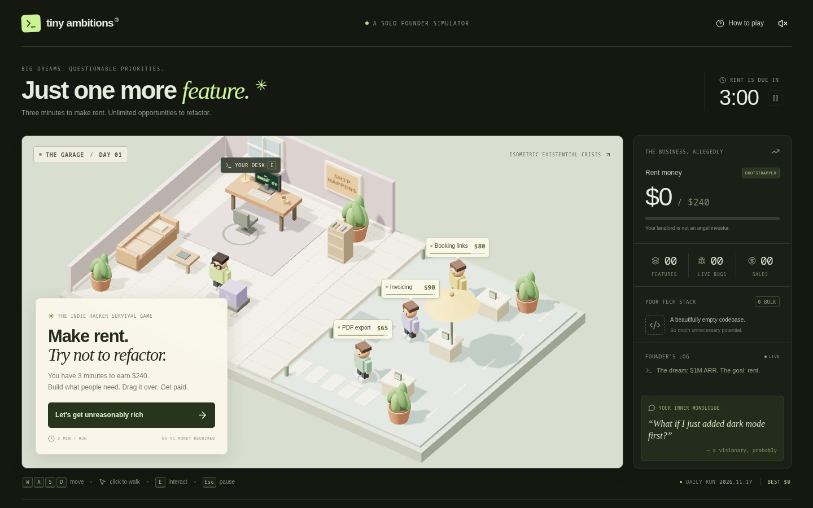
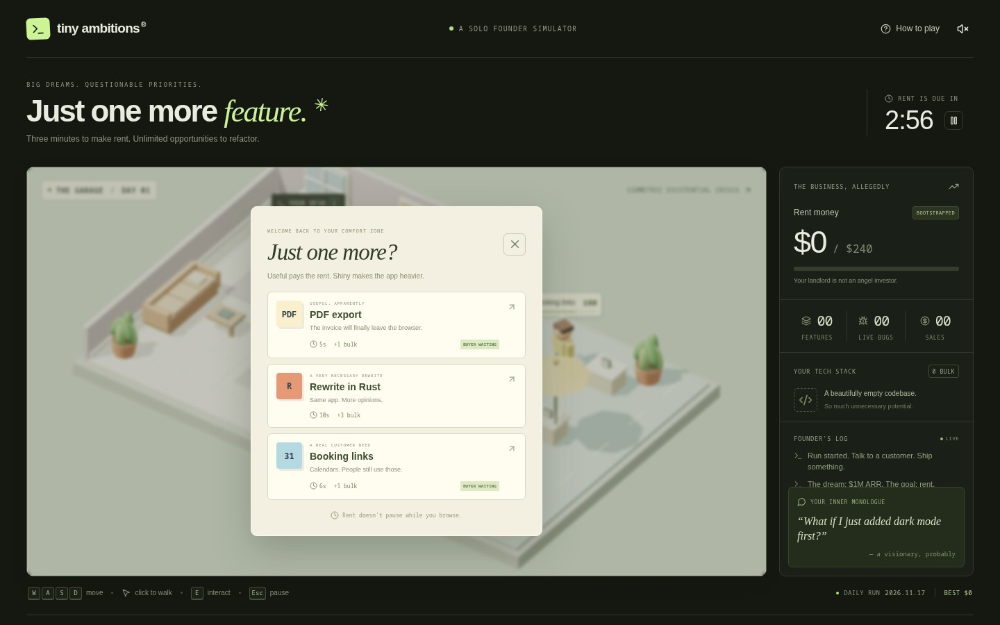
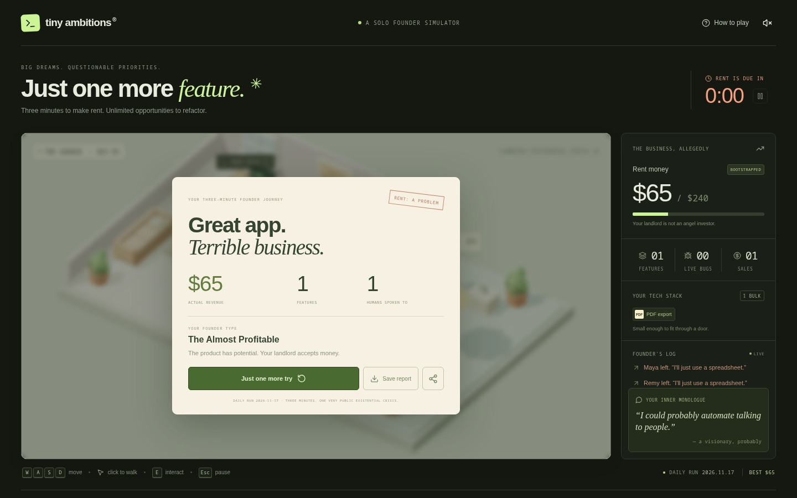

# Just One More Feature

Three minutes to make rent. Unlimited opportunities to refactor. A tiny browser game about being a solo founder.

[Play the game](https://gruz0.github.io/fdes/) · [Connect with Alexander Kadyrov](https://www.linkedin.com/in/alexanderkadyrov/) · [View the source](https://github.com/gruz0/fdes)



## The pitch

You are a solo founder in a garage. Rent is $240 and it is due in three minutes. Customers wander in asking for booking links, invoicing and PDF export. Your desk offers those features, and also a rewrite in Rust.

Build what people need, sell it before their patience runs out, and try not to refactor. It's a love letter to everyone with 12 unfinished side projects.

## How to play

1. **Find something worth building.** Each customer's bubble shows the feature they need and what they'll pay. Their patience runs out.
2. **Head to your desk.** Press <kbd>E</kbd> and choose a feature. Every feature adds bulk to your app, and the tempting extras add even more.
3. **Go outside and talk to a human.** Walk to a customer who wants a feature you have shipped and press <kbd>E</kbd> to sell. Features stay in your app for future sales.

Bugs slow you down. <kbd>E</kbd> squashes a nearby bug, and <kbd>X</kbd> at your desk fixes all of them in 4 seconds.



### Controls

| Key | Action |
| --- | --- |
| <kbd>W</kbd> <kbd>A</kbd> <kbd>S</kbd> <kbd>D</kbd> or arrow keys | Move |
| Click the floor | Walk there |
| <kbd>E</kbd> | Interact: open the desk, sell a feature, squash a bug |
| <kbd>X</kbd> at the desk | Fix all bugs |
| <kbd>Esc</kbd> | Pause |

## Daily run and founder report

Every day has its own run. Everyone who plays on the same date gets the same seed, so you can compare scores with friends. The game keeps your best score for each day.

When the clock runs out you get a founder report with your revenue, the features you shipped, the humans you talked to and your founder type. Share it as text or save it as an image.



## Data and privacy

The game runs entirely in your browser. There is no backend, no account and no leaderboard server. Your best score for each daily run is saved in your browser's local storage, on your own device only.

The production site uses cookie-free [Umami](https://umami.is/) analytics to count page visits. Nothing about your runs or scores is sent.

## Run locally

The game is a single self-contained HTML file, so you can open `index.html` in a browser directly. To serve it the way GitHub Pages does:

```bash
bun install
bun run dev
```

Then open <http://127.0.0.1:4173/>.

## Contributing

See [CONTRIBUTING.md](CONTRIBUTING.md) for the project layout, scripts, the smoke test, showcase-image generation and deployment notes.

## About the author

I'm [Alexander Kadyrov](https://www.linkedin.com/in/alexanderkadyrov/), a software engineer based in Dubai. I build AI solutions and MVPs, and work with founders as a fractional CTO. I have also shipped one more feature instead of talking to customers more often than I would like to admit.

If you need help building something, [book a call](https://cal.com/alexkadyrov/startups) or message me on LinkedIn.
